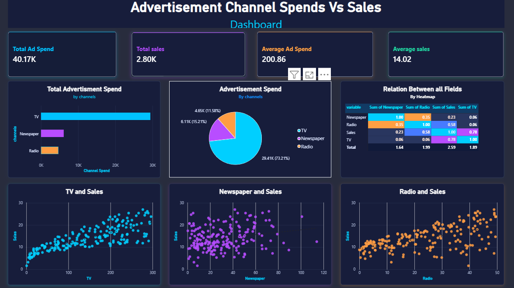

# Advertisement Sales Prediction

## Project Overview

This project focuses on predicting product sales based on advertising expenditure across three marketing channels: **TV**, **Radio**, and **Newspaper**. Using Exploratory Data Analysis (EDA) and Machine Learning, the project analyzes the relationship between advertising investments and sales, then builds a regression model to forecast sales from new advertising budgets.

## Project Objectives

* Analyze the impact of advertising expenditure on sales.
* Explore patterns and relationships within the dataset using visualizations.
* Build a regression model to predict sales.
* Evaluate model performance using standard regression metrics.

## Dataset Information

* **Source:** Kaggle
* **Features:** TV, Radio, Newspaper, Sales
* **Records:** 100
* The dataset contains no missing values or duplicate records, requiring minimal data preprocessing.

## Data Cleaning & Preprocessing

* Imported and inspected the dataset.
* Verified data types and dataset structure.
* Checked for missing values and duplicate records.
* Prepared the dataset for machine learning.

## Exploratory Data Analysis (EDA)

EDA was performed to understand the dataset and identify relationships between advertising channels and sales. The analysis includes:

* Scatter Plots
* Histograms
* Box Plots
* Correlation Heatmap
* Bar Charts
* Feature Relationship Analysis

## Machine Learning Model

A regression model was developed to predict sales using advertising expenditure as input features. The dataset was divided into training and testing sets, and the model was evaluated using multiple regression performance metrics.

## Evaluation Metrics

* Mean Absolute Error (MAE)
* Mean Squared Error (MSE)
* Root Mean Squared Error (RMSE)
* R² Score

## Results

The model successfully predicts sales based on advertising expenditure and demonstrates the relationship between different advertising channels and sales performance.

## Project Limitations

The provided dataset includes only advertising expenditure and sales information. Therefore, advanced analyses such as customer target segmentation, platform-wise performance analysis, customer retention analysis, and time-series sales forecasting could not be implemented because the required data fields were not available. All analyses and machine learning tasks supported by the available dataset have been successfully completed.

## Future Improvements

* Use a larger and more diverse dataset.
* Include customer demographic and behavioral features.
* Add platform-specific advertising information.
* Incorporate date/time features for time-series forecasting.
* Deploy the model as an interactive web application.

## Technologies Used

* Python
* Pandas
* NumPy
* Matplotlib
* Scikit-learn
* VS Code
* Git & GitHub

## Dashboard preview
